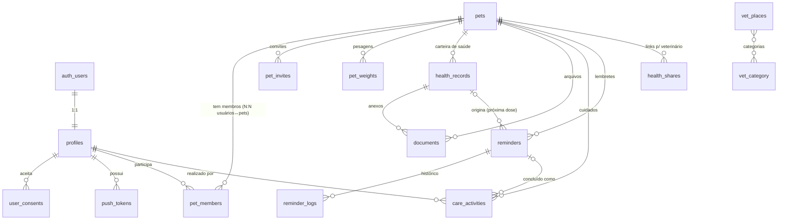

# Pet Friends — Planejamento Técnico do MVP

> ⚠️ **Documento histórico (02/11/2026).** Decisões posteriores mudaram partes dele: cores, abas, papéis (tutor/convidado), Locais por CEP e link do veterinário adiado. O que vale hoje está em `CLAUDE.md`, `docs/PLANO_APP_NATIVO.md` e `docs/DESIGN_SYSTEM.md`. O modelo de banco e a matriz de segurança continuam como base para a Etapa 2.

> *Casa do seu melhor amigo.*
> Documento da Etapa 1 (Planejamento). Status: **aguardando aprovação** do responsável pelo projeto.
> Data: 02/11/2026

---

## 0. Resumo executivo

- App mobile (iOS e Android) em **React Native + Expo (SDK atual) + TypeScript**, roteamento com **Expo Router**, estilo com **NativeWind**.
- Backend 100% **Supabase**: Postgres com **RLS em todas as tabelas**, Auth, Storage privado, Realtime para sincronização entre familiares e **Edge Functions** para tudo que exige segredo (convites, push, diretório veterinário, link seguro para veterinário, exclusão de conta).
- O controle de acesso gira em torno de uma única tabela: **`pet_members`** (quem pode ver/editar cada pet). Toda política RLS — inclusive de arquivos — deriva dela.
- O app nunca contém chaves privadas: só a `anon key` do Supabase e chaves públicas restritas (Google Maps por bundle ID / SHA-1).
- Pontos que **dependem de decisão sua** estão na seção 9 (identidade visual, fonte de dados do diretório, contas de lojas etc.).

---

## 1. Arquitetura técnica

```
┌──────────────────────────── App (Expo / React Native) ────────────────────────────┐
│  Expo Router (telas)                                                               │
│     │                                                                              │
│  Componentes UI (Design System, NativeWind)                                        │
│     │                                                                              │
│  Hooks de feature (usePets, useHealthRecords, useReminders...)                     │
│     │            │                                                                 │
│  Zustand (estado de cliente: sessão, pet ativo, preferências, cache leve)          │
│     │                                                                              │
│  Services (única camada que fala com Supabase / APIs)  ── Zod valida entrada/saída │
│     │                                                                              │
│  Integrações: supabase-js · expo-notifications · react-native-maps · Sentry        │
└─────┼──────────────────────────────────────────────────────────────────────────────┘
      │ HTTPS (JWT do usuário)
┌─────▼─────────────────────────────── Supabase ────────────────────────────────────┐
│  Auth (e-mail/senha + Apple/Google opcionais)                                      │
│  PostgreSQL + RLS + funções SQL (is_pet_member, has_pet_role)                      │
│  Storage privado (avatars, documentos) com RLS por pet                             │
│  Realtime (atividades, lembretes, registros de saúde de pets compartilhados)       │
│  Edge Functions (Deno, com service_role apenas no servidor):                       │
│    • invite-member / accept-invite     • send-push (Expo Push API)                 │
│    • reminders-dispatcher (cron)       • vet-directory (proxy Google Places)       │
│    • health-share-create / view        • delete-account (LGPD)                     │
│  pg_cron → dispara reminders-dispatcher                                            │
└────────────────────────────────────────────────────────────────────────────────────┘
      │
  Google Maps Platform (Maps SDK + Places API New) · Expo Push (APNs/FCM) · Sentry
```

### Decisões principais

| Tema | Decisão | Motivo |
|---|---|---|
| Builds | **Development builds (EAS)**, não Expo Go | Google Maps no iOS, push remoto, Skia (Victory Native XL) e Sentry nativo exigem código nativo. |
| Organização | Feature-first em `src/features/*`, cada feature com `components/ hooks/ services/ schemas/ types/` | Atende à organização por módulos pedida e evita pastas gigantes. |
| Estado | Zustand para estado de cliente; dados de servidor buscados via hooks + services | Stack definida. (Ver proposta opcional na seção 5.3.) |
| Validação | Um schema Zod por entidade, reutilizado no formulário (React Hook Form + zodResolver) e nos services | Fonte única de verdade; mensagens em pt-BR. |
| Tipos do banco | `supabase gen types` → `src/types/database.ts` | Tipagem ponta a ponta, sem `any`. |
| Permissões | Papéis por pet: `tutor`, `editor`, `leitor` | Cobre "gerenciar permissões" sem complexidade de ACL granular. |
| Lembretes | **Duas camadas**: notificações locais agendadas no dispositivo + push remoto via Edge Function/cron | Local funciona offline; remoto avisa familiares e cobre dispositivos que não agendaram. |
| PDF | `expo-print` (HTML → PDF) no dispositivo + `expo-sharing` | Sem servidor de PDF; dados não saem do app sem ação do usuário. |
| Link para veterinário | Token aleatório (guardado só como hash), com expiração e revogação; página somente-leitura servida por Edge Function | "Recurso seguro" sem exigir conta do veterinário. |
| Arquivos | Buckets **privados**; acesso por *signed URL* de curta duração | Documentos de saúde nunca ficam públicos. |
| Região | Projeto Supabase em **sa-east-1 (São Paulo)** | Latência e alinhamento com LGPD. |
| Datas | Banco em `timestamptz` (UTC) + fuso do usuário salvo; exibição com `date-fns` + locale `ptBR` | Evita bugs de lembretes em horário errado. |

---

## 2. Estrutura de diretórios

```
pet-friends/
├── CLAUDE.md
├── app.config.ts                 # Config Expo dinâmica (lê variáveis de ambiente)
├── eas.json                      # Perfis: development, preview (beta), production
├── babel.config.js / metro.config.js / tailwind.config.js / global.css
├── tsconfig.json                 # strict + paths (@/…)
├── .env.example                  # Somente variáveis EXPO_PUBLIC_* (nunca segredos)
├── app/                          # ROTAS (Expo Router) — telas finas, só composição
│   ├── _layout.tsx               # Providers, Sentry, fontes, guarda de sessão
│   ├── (auth)/
│   │   ├── entrar.tsx
│   │   ├── cadastro.tsx
│   │   └── recuperar-senha.tsx
│   ├── (app)/
│   │   ├── _layout.tsx
│   │   ├── (tabs)/
│   │   │   ├── _layout.tsx       # Abas: Início · Saúde · Cuidados · Veterinários · Perfil
│   │   │   ├── index.tsx         # Início (resumo do dia, próximos lembretes)
│   │   │   ├── saude.tsx         # Carteira do pet ativo
│   │   │   ├── cuidados.tsx      # Registro rápido + histórico
│   │   │   ├── veterinarios.tsx
│   │   │   └── perfil.tsx        # Meus pets, família, relatórios, conta
│   │   ├── lembretes/index.tsx   # Aberto pelo sino do cabeçalho
│   │   ├── pets/
│   │   │   ├── novo.tsx
│   │   │   └── [petId]/
│   │   │       ├── index.tsx     # Perfil do pet
│   │   │       ├── editar.tsx
│   │   │       ├── peso.tsx      # Histórico de peso (gráfico)
│   │   │       ├── saude/index.tsx · novo.tsx · [recordId].tsx
│   │   │       ├── cuidados/index.tsx · novo.tsx
│   │   │       ├── lembretes/novo.tsx · [reminderId].tsx
│   │   │       ├── familia/index.tsx · convidar.tsx
│   │   │       ├── historico.tsx # Linha do tempo
│   │   │       └── compartilhar.tsx  # PDF + link para veterinário
│   │   ├── veterinarios/[placeId].tsx
│   │   └── configuracoes/ privacidade.tsx · conta.tsx
│   └── convite/[token].tsx       # Deep link de aceite de convite
├── src/
│   ├── components/               # Design System (genéricos, sem regra de negócio)
│   │   ├── ui/                   # Button, Input, Select, DatePicker, Card, Avatar, Badge,
│   │   │                         # Chip, EmptyState, Skeleton, Toast, Sheet, Tabs...
│   │   ├── form/                 # Campos ligados ao React Hook Form
│   │   └── layout/               # Screen, Header, Section
│   ├── features/
│   │   ├── auth/      { components, hooks, services, schemas, types }
│   │   ├── pets/
│   │   ├── health/
│   │   ├── care/
│   │   ├── reminders/
│   │   ├── family/
│   │   ├── vets/
│   │   └── reports/
│   ├── hooks/                    # Hooks transversais (useSession, useRealtime, useDebounce)
│   ├── services/                 # Infra compartilhada (supabase client, storage, erros)
│   ├── stores/                   # Zustand (session, activePet, preferences)
│   ├── integrations/             # notifications, maps, sentry, sharing/print
│   ├── validation/               # Zod comuns (datas, telefone BR, peso) + mensagens pt-BR
│   ├── types/                    # database.ts (gerado), domain.ts
│   ├── config/                   # env.ts (validação Zod das env vars), constants.ts
│   ├── theme/                    # Tokens do Design System (cores, tipografia, espaçamento)
│   ├── i18n/                     # Textos pt-BR centralizados (strings.ts)
│   └── utils/                    # Formatação de datas, idade, máscaras
├── assets/                       # Logo, ícones, fontes oficiais, splash
├── supabase/
│   ├── config.toml
│   ├── migrations/               # SQL versionado (tabelas, RLS, funções, índices)
│   ├── seed.sql                  # Dados FICTÍCIOS só para dev local (nunca no diretório real)
│   ├── functions/
│   │   ├── _shared/              # cors, auth, validação Zod, supabase admin client
│   │   ├── invite-member/  accept-invite/
│   │   ├── send-push/  reminders-dispatcher/
│   │   ├── vet-directory/
│   │   ├── health-share-create/  health-share-view/
│   │   └── delete-account/
│   └── tests/                    # Testes de RLS (pgTAP)
├── __tests__/ (ou junto ao código como *.test.ts[x])
├── .maestro/                     # Fluxos E2E (login, cadastrar pet, registrar vacina...)
├── docs/
│   ├── PLANEJAMENTO.md
│   ├── DESIGN_SYSTEM.md          # Etapa 2
│   ├── ADR/                      # Registros de decisões técnicas
│   └── PRIVACIDADE.md            # Mapa de dados pessoais (LGPD)
└── .github/workflows/            # CI: lint, typecheck, testes, testes de RLS
```

---

## 3. Modelo do banco de dados

Convenções: chaves `uuid` (`gen_random_uuid()`), `created_at/updated_at timestamptz` com trigger, nomes em inglês no banco (textos de UI em pt-BR), exclusão lógica (`deleted_at`) em registros de saúde para preservar histórico. Extensões: `pgcrypto`, `postgis`, `pg_cron`.

### 3.1 Enums

```sql
create type species         as enum ('dog','cat');
create type pet_sex         as enum ('male','female','unknown');
create type member_role     as enum ('tutor','editor','viewer');   -- tutor | editor | leitor
create type health_type     as enum ('vaccine','dewormer','flea_tick','medication','vet_visit','exam');
create type care_type       as enum ('feeding','hydration','bath','walk','hygiene','medication','custom');
create type reminder_kind   as enum ('vaccine','medication','dewormer','flea_tick','vet_visit','bath','custom');
create type reminder_status as enum ('active','completed','cancelled');
create type vet_category    as enum ('clinic','hospital','emergency_24h','specialist','lab','home_care');
create type data_source     as enum ('google_places','manual_verified','official_registry');
```

### 3.2 Tabelas

```sql
-- Usuários (1:1 com auth.users)
profiles (
  id uuid pk references auth.users on delete cascade,
  full_name text not null,
  avatar_path text,
  timezone text not null default 'America/Sao_Paulo',
  notifications_enabled boolean not null default true,
  created_at, updated_at
)

-- Consentimentos LGPD (termos e política de privacidade versionados)
user_consents (
  id uuid pk, user_id uuid fk profiles on delete cascade,
  document text check (document in ('terms','privacy')),
  version text not null, accepted_at timestamptz not null default now()
)

-- Animais
pets (
  id uuid pk,
  name text not null check (char_length(name) between 1 and 60),
  species species not null,
  breed text,
  sex pet_sex not null default 'unknown',
  birth_date date, birth_date_is_estimate boolean default false,
  neutered boolean, microchip text,
  photo_path text,                      -- storage: pet-photos/{pet_id}/...
  allergies text, important_notes text,
  created_by uuid fk profiles,
  archived_at timestamptz,
  created_at, updated_at
)

-- Histórico de peso (alimenta gráfico Victory Native)
pet_weights (
  id uuid pk, pet_id uuid fk pets on delete cascade,
  weight_kg numeric(5,2) not null check (weight_kg > 0 and weight_kg < 200),
  measured_at date not null, recorded_by uuid fk profiles, created_at
)

-- Família / permissões (tabela central do controle de acesso)
pet_members (
  pet_id uuid fk pets on delete cascade,
  user_id uuid fk profiles on delete cascade,
  role member_role not null,
  invited_by uuid fk profiles,
  created_at,
  primary key (pet_id, user_id)
)
-- Invariante: todo pet tem ≥ 1 'tutor' (garantida por trigger)

pet_invites (
  id uuid pk, pet_id uuid fk pets on delete cascade,
  email citext,                         -- opcional (convite também pode ser só por link)
  role member_role not null,
  token_hash text not null unique,      -- só o hash é salvo
  invited_by uuid fk profiles,
  expires_at timestamptz not null, accepted_at timestamptz, accepted_by uuid, revoked_at timestamptz,
  created_at
)

-- Carteira de saúde (tabela única + detalhes tipados por Zod)
health_records (
  id uuid pk, pet_id uuid fk pets on delete cascade,
  type health_type not null,
  title text not null,                  -- ex.: "V10", "Bravecto", "Hemograma"
  occurred_on date not null,
  next_due_on date,                     -- gera lembrete automático (opcional)
  professional_name text, clinic_name text,
  details jsonb not null default '{}',  -- dose, lote, fabricante, posologia, resultado...
  notes text,
  created_by uuid fk profiles, updated_by uuid fk profiles,
  created_at, updated_at, deleted_at
)

-- Anexos (documentos e imagens)
documents (
  id uuid pk, pet_id uuid fk pets on delete cascade,
  health_record_id uuid fk health_records on delete set null,
  storage_path text not null unique,    -- pet-documents/{pet_id}/{document_id}.{ext}
  file_name text not null, mime_type text not null
    check (mime_type in ('image/jpeg','image/png','image/heic','application/pdf')),
  size_bytes int not null check (size_bytes <= 15728640),   -- 15 MB
  uploaded_by uuid fk profiles, created_at
)

-- Cuidados em casa ("quando" e "por quem")
care_activities (
  id uuid pk, pet_id uuid fk pets on delete cascade,
  type care_type not null,
  custom_label text,                    -- obrigatório quando type = 'custom'
  performed_at timestamptz not null default now(),
  performed_by uuid fk profiles not null,
  details jsonb not null default '{}',  -- quantidade de ração, duração do passeio...
  notes text,
  reminder_id uuid fk reminders on delete set null,
  created_at,
  check (type <> 'custom' or custom_label is not null)
)

-- Lembretes
reminders (
  id uuid pk, pet_id uuid fk pets on delete cascade,
  kind reminder_kind not null,
  title text not null, notes text,
  next_at timestamptz not null,         -- próxima ocorrência
  timezone text not null,
  recurrence jsonb,                     -- {freq:'daily'|'weekly'|'monthly'|'yearly', interval:int, until?:date, times?:['08:00','20:00']}
  status reminder_status not null default 'active',
  health_record_id uuid fk health_records on delete set null,
  notify_family boolean not null default true,
  created_by uuid fk profiles, created_at, updated_at
)

reminder_logs (                         -- histórico: concluído / adiado / pulado / cancelado
  id uuid pk, reminder_id uuid fk reminders on delete cascade,
  occurrence_at timestamptz not null,
  action text check (action in ('completed','snoozed','skipped','cancelled')),
  acted_by uuid fk profiles, acted_at timestamptz default now()
)

-- Dispositivos para push
push_tokens (
  id uuid pk, user_id uuid fk profiles on delete cascade,
  expo_push_token text not null unique,
  platform text check (platform in ('ios','android')),
  last_seen_at timestamptz, created_at
)

-- Diretório veterinário (dados com procedência obrigatória)
vet_places (
  id uuid pk,
  name text not null,
  categories vet_category[] not null,
  specialties text[] default '{}',
  address text not null, city text, state char(2),
  location geography(Point,4326) not null,
  phone text, whatsapp text, website text,
  opening_hours jsonb, hours_verified_at timestamptz,   -- só exibe horário se verificado
  source data_source not null, source_ref text,         -- ex.: place_id do Google
  verified_at timestamptz, last_synced_at timestamptz,
  is_active boolean not null default true,
  created_at, updated_at,
  unique (source, source_ref)
)
-- Índice GIST em location; RPC search_vet_places(lat, lng, radius_m, category, query)

-- Link seguro para veterinário
health_shares (
  id uuid pk, pet_id uuid fk pets on delete cascade,
  created_by uuid fk profiles,
  token_hash text not null unique,
  scope jsonb not null,                 -- {from?:date, to?:date, types:[...], include_documents:bool}
  expires_at timestamptz not null,      -- padrão 7 dias, máximo 30
  revoked_at timestamptz,
  last_accessed_at timestamptz, access_count int default 0,
  created_at
)
```

### 3.3 Visões e funções

- `pet_timeline` (view `security_invoker`): `UNION ALL` de `health_records`, `care_activities`, `pet_weights`, `reminder_logs` e `documents` com colunas comuns (`pet_id, kind, title, happened_at, actor_id, ref_id`) → alimenta a linha do tempo e o PDF.
- `is_pet_member(pet uuid) returns boolean` e `has_pet_role(pet uuid, roles member_role[])` — `security definer`, `stable`, `search_path` fixo.
- `create_pet(...)` — RPC transacional: cria o pet **e** a linha `pet_members` como `tutor`.
- `search_vet_places(...)` — busca geoespacial com PostGIS.

### 3.4 Matriz de permissões (RLS)

| Recurso | tutor | editor | leitor | não-membro |
|---|---|---|---|---|
| Ver pet, saúde, cuidados, lembretes, timeline | ✅ | ✅ | ✅ | ❌ |
| Criar/editar registros de saúde, cuidados, lembretes, anexos | ✅ | ✅ | ❌ | ❌ |
| Editar perfil do pet | ✅ | ✅ | ❌ | ❌ |
| Convidar/remover membros, mudar papéis | ✅ | ❌ | ❌ | ❌ |
| Criar/revogar link para veterinário, gerar PDF | ✅ | ✅ | ✅ (só PDF) | ❌ |
| Arquivar/excluir pet | ✅ | ❌ | ❌ | ❌ |
| Sair do compartilhamento | ✅ (se houver outro tutor) | ✅ | ✅ | — |
| `vet_places` | leitura para qualquer autenticado; escrita só via service_role | | | |

Storage: buckets `pet-photos` e `pet-documents` **privados**; políticas em `storage.objects` usam `is_pet_member((storage.foldername(name))[1]::uuid)`, e escrita exige `has_pet_role(..., '{tutor,editor}')`.

---

## 4. Relacionamentos entre tabelas



- **Usuário ↔ Pet** é N:N via `pet_members` (um pet tem vários familiares; um usuário tem vários pets).
- Tudo que pertence a um pet tem `pet_id` com `on delete cascade` → excluir o pet remove seus dados (e uma Edge Function/trigger remove os arquivos do Storage).
- Colunas de autoria (`created_by`, `performed_by`, `acted_by`) respondem "por quem" em cada atividade.
- `vet_places` é independente dos dados de usuários (não guarda favoritos/histórico de busca no MVP — menos dado pessoal).

---

## 5. Bibliotecas e dependências

### 5.1 App (todas compatíveis com Expo, instaladas via `npx expo install`)

| Finalidade | Pacote |
|---|---|
| Base | `expo`, `react-native`, `typescript`, `expo-router`, `expo-dev-client`, `expo-constants`, `expo-linking`, `expo-splash-screen`, `expo-font`, `expo-status-bar` |
| Estilo | `nativewind`, `tailwindcss`, `react-native-reanimated`, `react-native-safe-area-context`, `react-native-screens` |
| Formulários | `react-hook-form`, `zod`, `@hookform/resolvers` |
| Estado | `zustand` |
| Supabase | `@supabase/supabase-js`, `@react-native-async-storage/async-storage`, `expo-secure-store`, `react-native-url-polyfill` |
| Mídia/arquivos | `expo-image-picker`, `expo-document-picker`, `expo-image-manipulator` (compressão), `expo-image`, `expo-file-system` |
| Notificações | `expo-notifications`, `expo-device` |
| Mapas/localização | `react-native-maps` (provider Google), `expo-location` |
| Gráficos | `victory-native` (XL) + `@shopify/react-native-skia` + `react-native-gesture-handler` |
| PDF e compartilhamento | `expo-print`, `expo-sharing` |
| Datas | `date-fns` (locale `ptBR`) |
| Monitoramento | `@sentry/react-native` |
| UI auxiliar | `@expo/vector-icons` (ou o conjunto de ícones da identidade visual), `@react-native-community/datetimepicker`, `@gorhom/bottom-sheet` *(opcional)* |

### 5.2 Desenvolvimento e testes

`jest`, `jest-expo`, `@testing-library/react-native`, `eslint` + `eslint-config-expo`, `prettier`, `prettier-plugin-tailwindcss`, `supabase` (CLI), `pgTAP` (testes de RLS), Maestro (CLI), `eas-cli`, `husky` + `lint-staged` *(opcional)*.

### 5.3 Propostas fora da stack (exigem sua aprovação — **não serão usadas sem ela**)

1. ✅ **TanStack Query** — *aprovado em 02/11/2026.* Cache de dados do servidor, refetch, invalidação após eventos Realtime, estados de loading/erro. Zustand fica só com estado de cliente.
3. **`lucide-react-native` + `react-native-svg`** para ícones (ver `docs/DESIGN_SYSTEM.md` §5) — *aguardando aprovação.*
4. **Login social**: `expo-auth-session`/`@react-native-google-signin/google-signin` (Google) e `expo-apple-authentication` (Apple, só iOS) — decorrentes da decisão de login com Google.
2. **PostGIS** (extensão do próprio Postgres/Supabase) para busca por proximidade no diretório. Não é troca de stack, apenas extensão — listado por transparência.

---

## 6. Ferramentas e contas a configurar

| Ferramenta | O que configurar | Responsável |
|---|---|---|
| GitHub | Repositório, branch `main` protegida, GitHub Actions (CI) | Você cria o repo; eu configuro CI |
| Supabase | Projetos **dev** e **prod** (região São Paulo), Auth (e-mail + deep links de confirmação, SMTP próprio para produção), Storage, `pg_cron`, secrets das Edge Functions | Você cria a conta/projetos; eu escrevo migrations e funções |
| Expo / EAS | Conta Expo, `eas init`, perfis `development`/`preview`/`production`, EAS Secrets | Conta sua |
| Apple | Apple Developer Program (US$ 99/ano), App ID, chave APNs, App Store Connect, TestFlight | Você |
| Google Play | Play Console (US$ 25 único), FCM (Firebase project + `google-services.json`), trilha de teste interno | Você |
| Google Cloud | Projeto com faturamento; **Maps SDK Android/iOS** (chave restrita ao app) e **Places API (New)** (chave **só no servidor**, usada pela Edge Function); alertas de cota | Você cria; eu configuro restrições |
| Sentry | Projeto React Native, DSN (público), auth token só no EAS para upload de source maps | Você cria a conta |
| Maestro | CLI local + emuladores; opcional Maestro Cloud na CI | Eu |
| Jurídico/LGPD | Termos de uso, política de privacidade publicada em URL, e-mail do encarregado (DPO) | Você (eu preparo rascunho do mapa de dados) |
| Domínio | Para política de privacidade, deep links (universal links/app links) e página do link do veterinário | Você |

---

## 7. Planejamento de implementação

Cada etapa termina com **entrega revisável + critérios de aceite**. Só avanço para a próxima com sua aprovação.

### Etapa 1 — Planejamento *(este documento)*
✅ Arquitetura, pastas, banco, dependências, riscos, `CLAUDE.md`.

### Etapa 2 — Design
1. Receber a identidade visual oficial (logo, paleta, tipografia, elementos, referências).
2. `docs/DESIGN_SYSTEM.md` + `src/theme/tokens.ts` + `tailwind.config.js`: cores semânticas, tipografia, espaçamentos, raios, sombras, estados, modo claro (escuro opcional).
3. Componentes base com tela de catálogo interna (`/dev/catalogo`, removida do build de produção).
4. Mapa de navegação + protótipos das telas principais (Início, Perfil do pet, Carteira de saúde, Cuidados, Lembretes, Família, Veterinários, Compartilhar).
5. **Validação com você** antes de seguir.

### Etapa 3 — Fundação
1. Expo + TypeScript strict + Expo Router + NativeWind + ESLint/Prettier + Jest.
2. `app.config.ts` com variáveis validadas por Zod; perfis EAS; primeiro *development build* iOS/Android.
3. Supabase local (CLI) + migrations: enums, todas as tabelas, triggers, funções de permissão, **RLS**, buckets e políticas de Storage.
4. Testes pgTAP da matriz de permissões (seção 3.4) rodando na CI.
5. Autenticação: cadastro, login, recuperação de senha, confirmação de e-mail via deep link, aceite de termos, sessão persistente, logout, **exclusão de conta**.
6. Sentry + CI (lint, typecheck, testes).

### Etapa 4 — Funcionalidades (ordem aprovada)
| # | Módulo | Entregas-chave |
|---|---|---|
| 1 | Cadastro e perfil do pet | CRUD de pets (cão/gato), foto com compressão, múltiplos pets, seletor de pet ativo, histórico de peso com gráfico |
| 2 | Carteira digital de saúde | 6 tipos de registro com formulários específicos, anexos (foto/PDF), lista cronológica, filtros por tipo, "próxima dose" |
| 3 | Cuidados em casa | Registro rápido (1 toque) das 7 categorias, quem/quando, lista do dia e histórico |
| 4 | Lembretes e notificações | CRUD, recorrência, concluir/adiar/cancelar, notificações locais + push, lembrete automático a partir de "próxima dose", central de lembretes |
| 5 | Compartilhamento familiar | Convite por link/e-mail, aceite via deep link, papéis, remover membro, sair, Realtime entre familiares, push para familiares |
| 6 | Diretório veterinário | Busca por localização e categoria, mapa + lista, detalhes, botões ligar/WhatsApp/site/rotas; dados com procedência |
| 7 | Relatórios e histórico | Linha do tempo unificada, PDF com filtros de período/tipo, link seguro com expiração e revogação |

### Etapa 5 — Testes
Unitários (schemas, utils, services com mocks), componentes (RNTL), RLS (pgTAP), E2E Maestro (fluxos críticos: cadastro → pet → vacina → lembrete → convite), teste de sincronização com 2 contas, matriz de notificações (app aberto/fechado/morto, iOS/Android), dispositivos físicos iOS e Android, acessibilidade (leitor de tela, tamanho de fonte).

### Etapa 6 — Publicação
EAS Build `preview` → TestFlight + teste interno Play; correções do beta; formulários de privacidade das lojas (App Privacy / Data Safety); ícones, screenshots, descrições em pt-BR; EAS Submit `production`.

---

## 8. Riscos técnicos identificados

| # | Risco | Impacto | Mitigação |
|---|---|---|---|
| 1 | **Identidade visual ainda não foi fornecida** | Bloqueia a Etapa 2 | Preciso dos arquivos (logo vetorial, paleta, fontes com licença). Até lá, só tokens neutros provisórios. |
| 2 | **Fonte de dados do diretório veterinário**: não existe base pública e completa de clínicas no Brasil com API; os termos do Google Places **proíbem armazenar** a maior parte dos dados (só `place_id` pode ser guardado indefinidamente) | Alto (requisito "não inventar" + conformidade) | Edge Function faz proxy **em tempo real** do Places API (chave só no servidor) e guarda apenas `place_id`; categorias derivadas dos tipos do Google + base `manual_verified` curada por você para itens verificados (ex.: 24h, especialidades, domiciliar). Horário só aparece quando vier da fonte ou for verificado. **Decisão sua necessária.** |
| 3 | Custo do Google Maps Platform (Places é cobrado por chamada) | Médio | *Field masks* mínimas, debounce na busca, cache curto permitido, cotas e alertas de orçamento no GCP. |
| 4 | **iOS limita 64 notificações locais agendadas** | Lembretes recorrentes somem | Agendar janela deslizante (próximos ~30 dias, priorizando os mais próximos) e reagendar ao abrir o app; push remoto como reforço. |
| 5 | Confiabilidade de push (permissão negada, tokens expirados, Android com economia de bateria) | Médio | Pedir permissão no momento certo (ao criar o 1º lembrete), limpar tokens inválidos pelos *receipts* do Expo, mostrar lembretes pendentes dentro do app. |
| 6 | Fuso horário e horário de verão em lembretes | Médio | `timestamptz` + fuso IANA salvo por lembrete; testes com datas de borda. |
| 7 | Erros em RLS expõem dados de saúde de outros usuários | Crítico | RLS em 100% das tabelas, funções `security definer` com `search_path` fixo, testes pgTAP obrigatórios na CI, revisão de segurança antes do beta. |
| 8 | Sessão Supabase não cabe no `expo-secure-store` (limite ~2 KB por item) | Baixo | Padrão "LargeSecureStore": sessão criptografada no AsyncStorage com chave AES guardada no SecureStore. |
| 9 | Expo Go não suporta Maps Google no iOS, Skia/Sentry nativo, push remoto | Baixo | Usar *development builds* desde a Etapa 3. |
| 10 | Uploads grandes / HEIC do iPhone | Baixo | Compressão para JPEG com `expo-image-manipulator`, limite de 15 MB, validação de MIME no app **e** no bucket. |
| 11 | Link do veterinário vazado | Médio | Token de 256 bits, só hash no banco, expiração curta, revogação, contador de acessos, anexos via signed URL de minutos, `noindex`. |
| 12 | Conflito de edição simultânea entre familiares | Baixo | Registros são majoritariamente *append-only*; `updated_at` para detecção otimista nas edições. |
| 13 | Exigências das lojas (exclusão de conta in-app, Sign in with Apple por haver login Google, formulários de privacidade) | Médio (rejeição) | Exclusão de conta e "Entrar com Apple" (iOS) já na Etapa 3. |
| 16 | Cobertura do Google Places em Nova Iguaçu/Baixada pode ter cadastros incompletos ou desatualizados (telefone, horário) | Médio | Mostrar só o que a fonte fornece; curadoria manual priorizando 24h e hospitais da região; *proposta, sujeita a aprovação:* botão "Informar erro" que só gera revisão interna (não publica nada automaticamente). |
| 14 | Funcionamento offline | Médio | Fora do escopo do MVP como sincronização completa; app mostra último dado carregado e erros claros. Registrar como evolução futura. |
| 15 | Ambiente desta sessão é efêmero e **não há repositório Git conectado** | Perda de trabalho | Criar o repositório no GitHub e conectá-lo à sessão antes da Etapa 3. |

---

## 9. Decisões que preciso de você antes de avançar

1. ~~**Identidade visual**~~: recebida em 02/11/2026 (logo PNG + prancha). Cores do app = cores do logo. Ver `docs/DESIGN_SYSTEM.md`. Pendente: logo/símbolo em **vetor** para os ícones finais.
2. ✅ **Diretório veterinário**: abordagem Google Places (proxy em tempo real) + base curada. Lançamento em **Nova Iguaçu – Baixada Fluminense (RJ)**: mapa abre centrado em Nova Iguaçu quando a localização não é permitida; curadoria manual começa por Nova Iguaçu e municípios vizinhos (Mesquita, Nilópolis, Belford Roxo, Queimados, Duque de Caxias, São João de Meriti).
3. ✅ **TanStack Query**: aprovado — passa a fazer parte da stack (`@tanstack/react-query`).
4. ✅ **Login**: e-mail/senha + Google. **Obrigatório no iOS:** a Apple (diretriz 4.8 da App Store) exige que apps com login social de terceiros também ofereçam uma opção equivalente — na prática, **"Entrar com Apple"**. Ela aparecerá apenas no iPhone. Sem isso o app é rejeitado na revisão.
5. ✅ **Papéis**: `tutor` / `editor` / `leitor` aprovados.
6. **Contas**: existentes — Apple Developer, Google Play. **A criar** (gratuitas para começar): GitHub, Supabase, Expo, Google Cloud (exige cartão para faturamento do Maps), Sentry.
7. **Domínio**: há um domínio na Hostinger, ainda não definido. Até lá usamos o placeholder `petfriends` (scheme `petfriends://`; URL web via variável `EXPO_PUBLIC_WEB_URL`), trocável sem alterar código.
8. **Pendente — identificador do app (permanente):** bundle ID iOS / package Android **não podem ser mudados depois da publicação**. Proposta: `br.com.petfriends.app` (não exige ser dono do domínio). Confirmar antes da Etapa 3.
